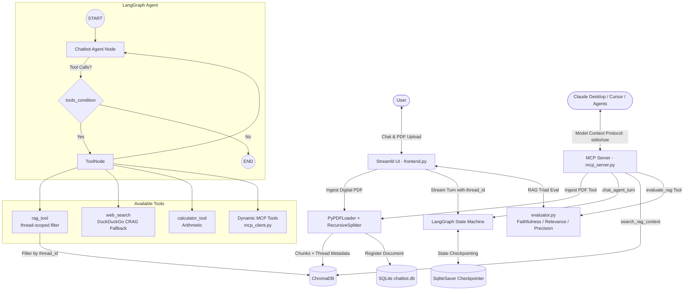

# 🤖 LangGraph Multi-Session Conversational Agent with Thread-Scoped RAG

A production-grade, stateful AI agent built with **LangGraph**, **ChromaDB**, **SQLite**, and **Streamlit**. The agent combines persistent conversational memory, multi-tenant document RAG, real-time web search, and arithmetic tools within an interactive ReAct workflow.

---

## 🌟 Key Features

- **Stateful Cyclic Agent (ReAct)**: Built using LangGraph's `StateGraph`, enabling cyclic reasoning (`Agent -> ToolNode -> Agent -> Complete`).
- **Thread-Isolated RAG**: Users can upload digital PDFs per chat session. Chunks are tagged and indexed in ChromaDB with metadata filters, guaranteeing zero document leakage across different conversation threads.
- **Corrective RAG (CRAG) with Autonomous Web Fallback**: If retrieved document chunks lack the necessary information, the agent autonomously triggers DuckDuckGo web search to fulfill the user's query without hallucinating.
- **RAG Triad Evaluation Engine (Faithfulness, Relevance, Precision)**: Built-in LLM-as-a-judge evaluation measuring groundedness, answer relevance, and context precision with both interactive UI scorecards and an automated CLI benchmark script (`evaluate_rag.py`).
- **Interactive Source & Citation Inspector**: Traceable citations showing document filename, page number, and exact text excerpts under every RAG response.
- **Fast Digital PDF Parsing (No OCR Overhead)**: Uses native PDF stream extraction (`pypdf` / `PyPDFLoader`), ensuring deterministic, lightweight, and high-speed processing without heavy OCR vision dependencies.
- **Persistent Multi-Session Memory**: Checkpointed with LangGraph's `SqliteSaver` across restarts and multi-turn dialogues.
- **Model Context Protocol (MCP) Integration**: Acts as an **MCP Server** (exposing tools, thread-isolated resources, and prompts over `stdio` and `sse` to Claude Desktop, Cursor, and agent networks) and an **MCP Client** (dynamically mounting external MCP tools into LangGraph).
- **Real-Time Streaming UI**: Built with Streamlit, rendering token-by-token message streaming, active tool status badges, MCP configuration drawers, and automatic conversation title generation.

---

## 🏗️ Architecture



---

## 📁 Project Structure

```
Chatbot/
├── backend/
│   ├── __init__.py        # Backend package initialization & exports
│   ├── backend.py         # LangGraph state graph, tools, CRAG engine, SQLite persistence
│   └── mcp_client.py      # Dynamic MCP client adapter mounting external tools into LangGraph
├── frontend/
│   ├── __init__.py        # Frontend package initialization
│   └── frontend.py        # Streamlit UI with streaming, MCP config inspector & eval scorecards
├── mcp_server.py          # Standard Model Context Protocol (MCP) Server (stdio & sse transports)
├── test_mcp.py            # Automated test harness for MCP tools, resources & prompts
├── mcp_servers.json.example # Example config for mounting external MCP servers
├── frontend.py            # Root Streamlit launcher entrypoint
├── evaluator.py           # Production RAG Triad evaluation module (LLM-as-a-judge)
├── evaluate_rag.py        # Automated CLI benchmark runner for RAG pipeline evaluation
├── requirements.txt       # Project dependencies (LangGraph, ChromaDB, MCP, Streamlit)
├── .env.example           # Environment variable template
├── chatbot.db             # SQLite database for threads, checkpoints, and document metadata
├── chroma_db/             # ChromaDB vector store directory
├── README.md              # Project overview & documentation
└── INTERVIEW_PLAYBOOK.md  # Comprehensive technical interview guide & cheat sheet
```

---

## 🚀 Quickstart

### 1. Clone & Setup Virtual Environment
```bash
python3 -m venv venv
source venv/bin/activate
pip install -r requirements.txt
```

### 2. Configure Environment Variables
Copy `.env.example` to `.env` and configure your keys:
```bash
cp .env.example .env
```
Edit `.env`:
```ini
OPENAI_API_KEY=sk-proj-your-key-here
```
*(Optional: You can also configure Ollama for local models via `OLLAMA_MODEL` and `OLLAMA_BASE_URL`)*

### 3. Run the Application
```bash
streamlit run frontend.py
# or: streamlit run frontend/frontend.py
```
Open your browser at `http://localhost:8501`.

### 4. Run the Model Context Protocol (MCP) Server
You can expose the conversational RAG agent as an MCP server:

```bash
# Stdio mode (for Claude Desktop, Cursor, Antigravity CLI)
python mcp_server.py

# SSE mode (for remote network agents over HTTP)
python mcp_server.py --transport sse --port 8000
```

### 5. Automated Testing Suites
```bash
# Run end-to-end integration test (PDF Ingestion, RAG Q&A, Memory, Isolation)
python test_system_integration.py

# Run Model Context Protocol server tests
python test_mcp.py

# Run Production MCP client harness
python test_mcp_client.py

# Run RAG Triad Evaluator benchmark (Faithfulness, Relevance, Precision)
python evaluate_rag.py
```

---

## 🐳 Docker Deployment

The application is containerized and ready for production deployment using Docker and Docker Compose.

### Option A: Using Docker Compose (Recommended)
```bash
# 1. Ensure your .env has OPENAI_API_KEY
cp .env.example .env

# 2. Build and launch all services in detached mode
docker compose up -d --build

# 3. View container logs
docker compose logs -f

# 4. Stop containers
docker compose down
```
Access the application at:
- **Streamlit Web UI**: `http://localhost:8501`
- **MCP SSE Server**: `http://localhost:8000/sse`

### Option B: Using Standalone Docker CLI
```bash
# Build image
docker build -t langgraph-rag-chatbot:latest .

# Run Streamlit UI
docker run -d --name chatbot-ui -p 8501:8501 --env-file .env langgraph-rag-chatbot:latest

# Or run MCP SSE server
docker run -d --name chatbot-mcp -p 8000:8000 --env-file .env langgraph-rag-chatbot:latest mcp
```

---

## 🔌 Model Context Protocol (MCP) Integration

This project implements the open **Model Context Protocol (MCP)** specification:

### 1. Exposed MCP Tools
| Tool | Description | Parameters |
| :--- | :--- | :--- |
| `chat_agent_turn` | Executes a full turn through the LangGraph cyclic agent with memory & CRAG | `message` (str), `thread_id` (str) |
| `search_rag_context` | Performs thread-scoped vector retrieval against ChromaDB | `query` (str), `thread_id` (str), `top_k` (int) |
| `ingest_pdf_document`| Ingests a local digital PDF and binds it to a conversation thread | `file_path` (str), `thread_id` (str) |
| `calculate_expression`| Evaluates arithmetic expressions safely using AST parsing | `expression` (str) |
| `evaluate_rag` | Evaluates Faithfulness, Relevance, and Precision with LLM-as-a-judge | `question` (str), `context` (list), `answer` (str) |
| `list_conversation_threads` | Lists all active persistent conversation threads in SQLite | _None_ |
| `create_conversation_thread` | Creates a new isolated conversation thread session | `title` (str) |

### 2. Exposed MCP Resources
| Resource URI | Description | MIME Type |
| :--- | :--- | :--- |
| `rag://threads` | List of all active threads and session titles | `application/json` |
| `rag://threads/{thread_id}/documents` | All documents indexed for the specified thread | `application/json` |
| `rag://threads/{thread_id}/history` | Serialized message history from LangGraph checkpointer | `application/json` |
| `rag://system/status` | System health, database connection, and indexing counts | `application/json` |

### 3. Client Configuration

#### Claude Desktop
Add to `~/Library/Application Support/Claude/claude_desktop_config.json`:
```json
{
  "mcpServers": {
    "langgraph-rag-agent": {
      "command": "python",
      "args": ["/Users/harshsinghal/Desktop/llm/Chatbot/mcp_server.py"]
    }
  }
}
```

#### Cursor IDE
Add to `.cursor/mcp.json`:
```json
{
  "mcpServers": {
    "rag-agent": {
      "command": "python",
      "args": ["/Users/harshsinghal/Desktop/llm/Chatbot/mcp_server.py"]
    }
  }
}
```

---

## 🛠️ Tech Stack & Design Choices

| Component | Technology | Rationale |
| :--- | :--- | :--- |
| **Agent Framework** | **LangGraph** | Enables cyclic graphs (ReAct), fine-grained state control, and built-in checkpointers over rigid sequential chains. |
| **Vector Database** | **ChromaDB** | Embedded, lightweight, and supports powerful metadata filtering for multi-session document scoping. |
| **Text Extraction** | **PyPDFLoader (`pypdf`)** | Native digital extraction: deterministic, fast, zero heavy vision dependencies (no OCR complexity). |
| **Chunking Strategy** | **RecursiveCharacterTextSplitter** | Preserves semantic paragraph & sentence boundaries (1000 characters, 200 overlap). |
| **State Persistence**| **SQLite (`SqliteSaver`)** | Thread-isolated checkpointing; conversations resume seamlessly across sessions. |
| **User Interface** | **Streamlit** | Rapid, reactive Python UI supporting token streaming (`st.write_stream`) and live status badges (`st.status`). |

---

## 📖 Interview Guide

For a full breakdown of how to present this project, answer tough architectural questions, and explain all design decisions, see [INTERVIEW_PLAYBOOK.md](INTERVIEW_PLAYBOOK.md).
